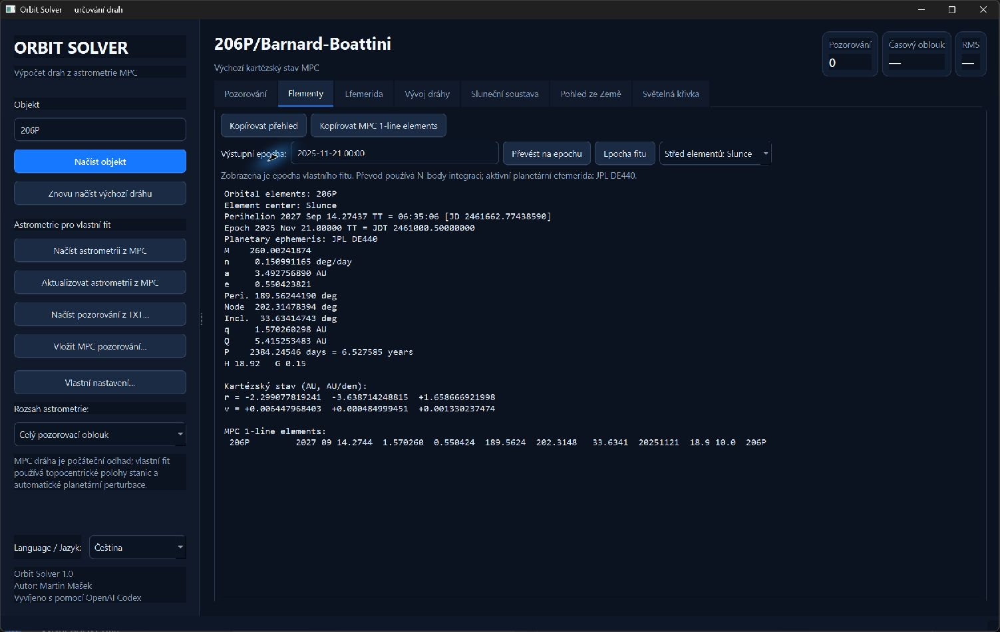
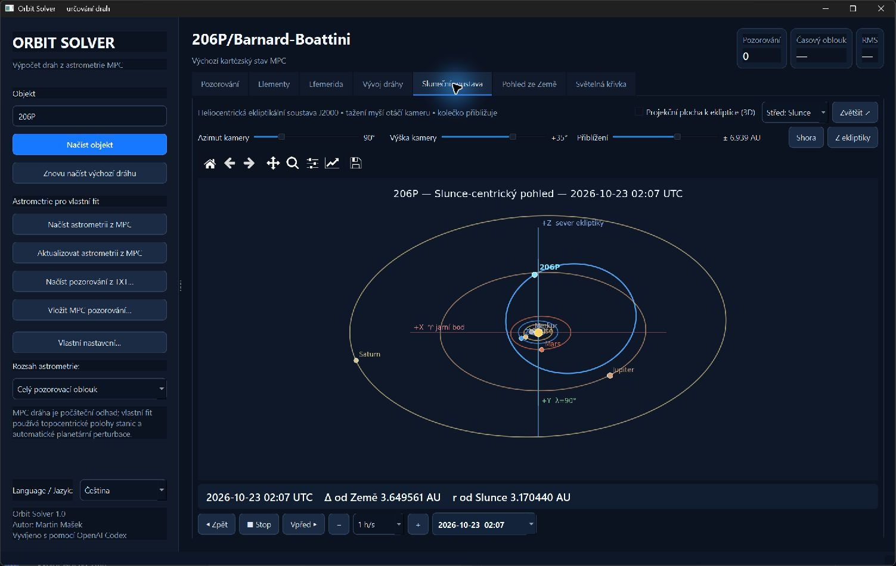

# Orbit Solver

**Česky** | [English](README.md)

[](https://www.python.org/)
[](https://doc.qt.io/qtforpython-6/)
[](https://github.com/cassi-astronomy/Orbit-Solver)
[](LICENSE)

Desktopová aplikace pro načítání astrometrie Minor Planet Center, určování drah
planetek a komet, tvorbu efemerid a vizualizaci jejich pohybu. Program má anglické a české
uživatelské rozhraní a běží ve Windows i Linuxu.

Výchozím jazykem je angličtina. Češtinu zvolíte v levém panelu přepínačem
**Language / Jazyk**; program se restartuje v novém jazyce a volbu si
zapamatuje i pro další spuštění.

## Ukázka: kometa 206P/Barnard–Boattini

Dráhové elementy načtené z MPC včetně kartézského stavu a jednořádkového
formátu MPC:



Heliocentrický pohled v ekliptikální soustavě J2000 zobrazuje dráhu komety
společně s drahami planet a jejich aktuálními polohami:



## Hlavní možnosti

### Astrometrie a určení dráhy

- načtení výchozí kartézské dráhy z Minor Planet Center;
- samostatné stažení pozorování z MPC nebo NEOCP/PCCP;
- místní cache astrometrie z MPC: jednou stažená pozorování objektu (např.
  1P) se uloží do `orbit-data/mpc-cache` a příště se načtou okamžitě bez
  dotazu do MPC; tlačítko **Aktualizovat astrometrii z MPC** stáhne aktuální
  data včetně nových pozorování a cache přepíše (objekty z NEOCP/PCCP se
  kvůli rychlým změnám neukládají);
- u komet služba MPC pro pozorování vynechává měření rozpadlé komety označená
  písmenem fragmentu (205P: 680 z 2016 řádků); program proto po ní načte
  textový výpis objektu z webu MPC (stránka `show_object` a její soubor
  `tmp2/…txt`) a přidá z něj měření fragmentů A, B, C …, přičemž řádky ADES
  si ponechají své nejistoty; bez webu MPC se použijí jen řádky ze služby;
  komety uložené v cache dříve se jednou stáhnou znovu;
- import pozorování ze souboru a vložení ze schránky ve formátu MPC 80-column;
- krátké oblouky těles velmi blízko Země (až několik zemských poloměrů, např.
  2008 TC3 hodinu a 2024 BX1 minuty před dopadem): předběžné hledání
  vzdálenosti sahá až k 10 000 km, zahrnuje rotaci Země u pozorovatele, Zemi i
  Měsíc, při neúspěchu hrubého hledání doladí všech šest složek stavu a
  trajektorie procházející planetou se odmítne jako srážka; u 2024 BX1
  souhlasí předpovězený vstup (00:32:37 UTC, 15,20 km/s, 75,6°) s pozorovaným
  bolidem;
- dlouhé oblouky dočasně zachycených družic Země (například J002E3) se nejprve
  určí z prvního hustého lokálního úseku a potom se rozšiřují po krocích bez
  ztráty fáze; fit zahrnuje zploštění Země J2 a prověří konstantní radiální
  tlak slunečního záření A1/r² vhodný pro prázdný raketový stupeň;
- podpora družicových pozorování a topocentrické paralaxy podle kódu stanice MPC;
- vlastní šestiparametrový fit kartézského stavu s planetárními perturbacemi;
- rychlý fit velkých souborů z časově i početně reprezentativního vzorku;
  dlouhé oblouky, negravitační řešení a husté objevitelské oblouky se
  závěrečně korigují na všech povolených měřeních;
- výpočet z celého oblouku nebo pouze z posledních 2, 5 či 10 let;
- ruční zařazení a vyřazení jednotlivých pozorování;
- barevná rezidua O−C, automatické vyřazení reziduí nad 2″ a funkce `Worst obs`;
- import historických 80sloupcových záznamů s nižší přesností (RA na celé
  sekundy či minuty, Dec na desetiny minuty); jejich nejistota nikdy není
  menší než polovina posledního publikovaného řádu;
- úplná kovariance každého měření ADES: `rmsRA`, `rmsDec` a `rmsCorr`, přičemž
  `rmsTime`/`uncTime` se promítne podél změřeného pohybu po obloze; nejistota
  má nadále dolní mez 0,3″ kvůli neuvedeným systematikám; u měření bez RMS
  z ADES se použijí výchozí hodnoty podle techniky, epochy a běžných stanic
  podle Vereše et al. (2017); série jedné stanice z jedné místní noci se převáží pravidlem
  `sqrt(N/4)` podle Vereše et al. (2017), aby stovky snímků nepředstíraly
  stovky nezávislých absolutních poloh;
- duplicitní redukce téhož měření (MPC je často uvádí vůči více hvězdným
  katalogům, např. PPM a UCAC-4) se rozpoznají a fituje se jen ta s nejlepším
  katalogem; záznamy, které MPC označuje jako nahrazené (`X`, ADES
  `deprecated`), se nefitují;
- rozpadlé komety: označení fragmentů z MPC (sloupec 12 formátu 80 znaků,
  např. `0205P      b`, nebo přípona `-B` v označení ADES) se rozpozná; pokud
  astrometrie obsahuje více složek, objeví se volba **Fragment komety** a fituje
  se jen vybraná složka; předvybraná je hlavní (přeživší) složka – ta, která je
  označena v nejvíce pozorovaných návratech, a při shodě ta nejvíce pozorovaná,
  takže u 73P/Schwassmann–Wachmann je to C, ne krátce žijící A; neoznačená
  měření – mateřská kometa před rozpadem, přeživší jádro v pozdějších návratech,
  které už MPC písmenem neoznačuje, nebo hlášení, která fragmenty nerozlišila –
  patří hlavní složce; řádky ostatních složek zůstanou v tabulce s O−C, ale bez váhy;
- neoznačená druhá stopa, kterou jedna stanice změřila na stejných snímcích
  (fragment nebo jiný objekt, např. ZTF u 205P v roce 2021, 65″ od komety), se
  rozpozná i tehdy, když dráhu stáhla mezi obě stopy, a vyřadí se jako
  souvislá vedlejší stopa (i když vážená stopa nejdřív přišla o několik
  měření jako izolovaná odlehlá); stejně se vyřadí celý kompaktní tracklet
  `trkSub` nebo stanice/noc, který je silně neslučitelný alespoň se šesti dobře
  fitovanými nezávislými měřeními; důvod je viditelný a bezpečnostní limit je
  15 % všech měření;
- nad tabulkou pozorování upozorní pruh na rozpadlou kometu: složky, období
  pozorování, počet nocí a medián odstupu od hlavní složky na společných
  snímcích; **Přehled fragmentů…** ukáže složky i s jejich vlastními drahami.
  Nalezenou neoznačenou stopu lze udělat samostatnou složkou (**Vyčlenit stopu
  jako úlomek**, označení X1, X2…). Vedlejší složka se fituje od dráhy hlavní
  (při oblouku kratším než rok čistě gravitačně). Po každém fitu složky se
  neoznačená měření po rozpadu poblíž měření vedlejší složky přiřadí té
  složce, jejíž dráze odpovídají (do 3″ a třikrát blíž než ke druhé); měření,
  na která sedí obě dráhy stejně, zůstanou hlavní složce;
- **Odhadnout čas rozpadu…** určí okamžik oddělení každé vedlejší složky
  s vlastní drahou od hlavní třemi modely – Sekaninův rozpad s rozdílným
  radiálním zrychlením (∝ r⁻²), impulz rychlosti oddělení Δv (R/T/N) a oba
  současně – hledá až 1,6 oběžné doby zpět a uvede okamžik s nejistotou,
  heliocentrickou vzdálenost, Δv/ΔA1, konkurenční řešení a varování pro
  nefyzikální rychlost (> 10 m/s), nadměrné rozdílné zrychlení nebo minimum
  na starším okraji intervalu (okamžik neurčen); minimum těsně před prvním
  měřením fragmentu je platný výsledek – čerstvý fragment – a tak se i uvede.
  Krátký oblouk fragmentu často připouští více okamžiků; výsledek je orientační;
- ostatní složky s vlastní drahou se kreslí jako průvodci (růžově) v pohledech
  Sluneční soustava a Pohled ze Země; pohled ze Země nabízí i pole 0,25°, 1° a 5°;
- časy před rokem 1960 jsou světový čas UT a na TT se převádějí podle ΔT
  z rekonstrukce rotace Země (Espenak & Meeus), ne pevným posunem 32,184 s;
- navazování vzdálených návratů pro jakékoli těleso (periodické komety,
  víceopoziční planetky): pozorování se rozdělí na aparice podle mezer delších
  než polovina oběžné doby (nejméně 300 dní) a jedna aparice nikdy nepřesáhne
  tři čtvrtiny oběžné doby, takže několikaleté sledování přehlídkami nesloučí
  po sobě jdoucí návraty; pokud výchozí dráha všechny
  aparice předpovídá, opraví se společně; jinak se samostatně napasuje nejlépe
  pozorovaný návrat (z katalogové dráhy, případně z vlastních úhlů postupným
  rozšiřováním oblouku) a další návraty se připojují po jednom, časově
  nejbližší první; když předpověď pro diferenciální korekci nestačí, hledá se
  správná větev podél linie variací (LOV) – nejslabšího směru kovariance, tedy
  rodiny drah, které stále sedí na již navázanou astrometrii; každý návrat je
  přijat, jen pokud sedí na vlastní astrometrii (normalizované RMS ≤ 3σ po
  omezeném a viditelném vyřazení hrubých chyb); dříve navázané návraty se
  přitom smějí posunout nejvýše do 6σ a takové napětí modelu (typicky
  proměnlivá aktivita komety) program výslovně vypíše; návraty, které již
  navázaná dráha dobře předpovídá, se připojí najednou v jedné korekci;
  návrat, který se nepodařilo připojit, se zkusí znovu poté, co přibudou
  další navázané návraty;
  požadované A1/A2 se fitují, jakmile oblouk pokrývá celý oběh (dvě perihelia),
  ostatní požadované parametry v závěrečném společném řešení; takto se např. 206P/Barnard–Boattini (1892
  a 2008, 20 oběhů a tři přiblížení k Jupiteru) naváže i bez katalogové dráhy;
- volby navazování ve **Vlastním nastavení…**: *zvlášť negravitační
  parametry pro historické návraty* fitují vlastní A1H/A2H/A3H před okamžikem
  přepnutí a A1–A3 po něm (kometa, jejíž aktivita se změnila, zatímco byla
  ztracená; 205P: 1896 a 2008–2021); výchozí přepnutí je ve středu nejdelší
  mezery v pozorováních a lze ho zadat jako libovolný rok uvnitř mezery –
  nejlépe okamžik změny aktivity, např. rozpad daleko od Slunce; více let
  oddělených čárkou dá až čtyři období sil (A1–A3, A1H–A3H, A1H2–A3H2,
  A1H3–A3H3), každé fitované ze svých návratů (78P s přepnutím v letech 1993
  a 2008, kolem průletu u Jupiteru 1995: RMS 1,16″ proti 1,42″ se dvěma obdobími a 2,04″ s jednou sadou; příčné A2 tří období, −0,66, −1,28 a −1,13·10⁻⁹ AU/den², odpovídá Kinoshitovým −0,43, −1,26 a −1,23); *připojit
  návrat i nad limitem kvality* přijme návrat až do 15σ, pokud ostatní návraty
  zůstanou v mezích napětí modelu, a vždy ho vykáže jako napětí modelu;
  *zvětšit nejistotu měření pořízených před rokem* násobí σ staré mikrometrické
  a fotografické astrometrie, jejíž soustavné chyby (katalog, měřítko desky,
  pozorovatel) se průměrováním nezmenší;
  u 205P (s JPL DE440, A1+A2 a A1H/A2H přepnutými koncem roku 1998, kdy se
  oddělil úlomek C) se napojí všechny čtyři návraty bez volby napojení nad
  limitem: 1896 na 9,5″/3,1σ, se 3× větší nejistotou před rokem 1950 na
  12,8″/1,4σ, 2008–2021 na 1,0–1,9″; historické A2H (+2,8·10⁻¹⁰) má opačné
  znaménko než dnešní A2 (−3,6·10⁻¹⁰);
- fit oblouku delšího než 10 let bez JPL DE440 před spuštěním i ve výsledku
  varuje: s analytickým modelem planet může být napojení přes těsná setkání
  s Jupiterem zcela chybné (206P, 1892–2008: 8″ s DE440, 14 000″ bez něj);
- integrace oblouků delších než dva roky používá přesnou toleranci
  (`rtol = 1e-12`); přes staletí a těsná setkání s Jupiterem by volnější
  tolerance vnesla chybu stovek obloukových vteřin;
- volitelné fixování oskulačních elementů;
- předem volitelná výstupní epocha; fit zůstává kvůli stabilitě uprostřed
  pozorovacího oblouku a výsledné elementy se následně převedou N-body integrací;
- volitelný fit negravitačních parametrů A1, A2 a A3 pro libovolné těleso:
  Marsdenův vodní model s volitelným časovým posunem aktivity DT pro komety,
  nebo mocninný model `g(r) = r^-m` (výchozí `m = 2`) pro tlak záření a
  Yarkovského A2 u planetek; označení tělesa funkci neomezuje; pokud uživatel
  silový model nezvolil, fit konzervativně prověří A1 (u dostatečně dlouhého
  oblouku komety A1+A2), případně planetkové A2/r² na oblouku delším než dva
  roky, ale přijme je jen tehdy, když má každý nový parametr významnost
  alespoň 3σ a zlepšení je ΔBIC > 10;
- nejistoty elementů a základní diagnostika fitu; při singulární nebo extrémně
  špatně podmíněné normální matici se nejistota raději neuvede, než aby
  pseudoinverze vytvořila falešně přesné číslo;
- u planetek výpis elementů uvádí průměr odpovídající H,
  D = 1329 km / √p_V · 10^(−H/5), pro obvyklý rozsah albeda 0,25 (světlý typ S)
  až 0,05 (tmavý typ C) a krajní meze 0,50–0,03; u komet se neuvádí (H/M aktivní
  komety měří komu) ani tehdy, když je H jen zástupná hodnota (bez katalogového
  H a bez fotometrie);

### Elementy a efemerida

- přehled orbitálních elementů včetně nejistot;
- u navázaných návratů (a u komety s dlouhým obloukem) spočte fit jednu
  integraci od prvního pozorovaného návratu po první návrat po dnešku; Vývoj
  dráhy ji ihned zobrazí celou – oskulační elementy v každém návratu,
  přiblížení k planetám, průběh elementů v grafu i trajektorii ve Sluneční
  soustavě – bez nového spouštění integrace; tlačítko Spustit integraci slouží
  jen pro jiný rozsah;
- převod elementů na uživatelem zvolenou epochu;
- oskulační elementy vůči Slunci; elementy vůči planetě se nabízejí jen tehdy,
  když je těleso k planetě gravitačně vázané (uvnitř Hillovy sféry se zápornou
  planetocentrickou energií, např. Shoemaker–Levy 9 u Jupiteru nebo dočasně
  zachycený měsíček Země);
- kopírovatelný textový výstup a MPC 1-line elements;
- geocentrická nebo topocentrická efemerida pro zvolenou MPC stanici;
- numerická N-body propagace z kartézského stavu i u čistě gravitační dráhy,
  časový argument TDB a iterovaná korekce na dobu letu světla;
- astrometrické RA/Dec v soustavě ICRS/J2000 v desetinném i sexagesimálním
  formátu; převod na obzorové souřadnice zahrnuje precesi, nutaci a aberaci;
- azimut, výška objektu, výška Slunce, vzdálenosti a elongace;
- formální poziční nejistota 1σ v obloukových sekundách;
- kopírování obdélníkového výběru z tabulky.

### Vizualizace

- interaktivní pohled na Sluneční soustavu s otáčením, plynulým logaritmickým
  přiblížením a volitelným středem na Slunci, planetě nebo fitovaném tělese;
  geocentrický detail zobrazuje Měsíc na efemeridové dráze odpovídající
  zvolenému datu a smyčky zjištěných dočasných zachycení se znovu integrují
  jemným krokem, takže zůstávají hladké i v dlouhém vývoji;
- oskulační křivka tělesa se odvozuje z N-body stavu aktuálního snímku, takže
  animovaný bod neleží mimo starou křivku z epochy původního fitu;
- volitelná průsvitná projekční plocha dráhy k rovině ekliptiky pro názorné
  zobrazení sklonu, výšky nad/pod ekliptikou a uzlů dráhy;
- rovníková mapa oblohy, středová azimutální projekce a obzorový graf viditelnosti;
- hvězdy do 6. magnitudy, obrazce a latinské zkratky 88 souhvězdí, rovník a ekliptika;
- volné posouvání mapy, sledování objektu a samostatné zvětšené okno;
- světelná křivka pro planetky i komety s nastavitelným fotometrickým modelem
  a souběžnými křivkami vzdálenosti od Země a od Slunce; v grafu je vyznačeno
  také heliocentrické přísluní.

### Dlouhodobý vývoj dráhy

- integrace podle počtu minulých/budoucích návratů nebo podle samostatného počtu
  let v obou směrech; panel ukazuje, jaké kalendářní roky volba pokrývá, rozsah
  mimo aktivní planetární efemeridu (DE440: 1549–2650) program nabídne omezit
  na její pokrytí a integrace delší než 1000 let vyžaduje potvrzení;
- tabulka oskulačních elementů v jednotlivých perihelových průchodech, označených
  přímo rokem návratu;
- volitelný **rozptyl klonů** (standardně vypnutý, 5–500 klonů): klony
  z kovariance vlastního fitu – stav dráhy i fitované A1/A2/A3/DT – se integrují
  přes stejný interval a v grafu se kreslí jako slabé křivky s pásmem 5–95 %;
  TXT přehled uvádí rozptyl q, e a P u každého návratu. Ukazuje, jak velkou
  část předpovědi určují pozorování, ale jen v rámci zvoleného silového
  modelu: u 78P zůstane 30 klonů v rozmezí q 5,051–5,057 AU i po průletech
  kolem Jupiteru v letech 2029 (0,018 AU) a 2046, zatímco řešení s jiným
  negravitačním modelem (Kinoshita) skončí jinde – tam rozhoduje volba
  modelu, ne astrometrie. Každý klon je jedna další úplná integrace (asi 5 s
  na 125 let);
- hledání přiblížení k planetám, vzdálenost v AU a Hillových poloměrech,
  relativní rychlost a orientační změna `1/a`;
- automatická detekce planetocentrického zachycení podle záporné relativní
  orbitální energie uvnitř Hillovy sféry;
- těsné průlety kolem Měsíce se vypisují odděleně od setkání se Zemí; gravitace
  Měsíce je zahrnuta po celou integraci, takže se v dráze zachová i měsíční
  postrčení měnící dočasné zachycení nebo únik;
- přepínatelný graf průběžného vývoje `q`, `a`, `e`, periody, `1/a`, sklonu,
  uzlu nebo argumentu perihelu na lineární časové ose; změny při setkáních se
  projeví v okamžiku setkání a setkání jsou v grafu vyznačena;
- chronologický export jako čitelný tabulkový TXT nebo MPC 1-line elements;
- zobrazení numericky integrované minulé a budoucí trajektorie výrazně odlišnými
  barvami ve Sluneční soustavě; právě probíhající návrat je během animace
  zvýrazněn silnější světlou čarou, zatímco starší a budoucí revoluce zůstávají
  tenké a tlumené; významné planetární setkání je označené jako dynamická
  „výhybka“ a v okamžiku průletu se zvýraznění přepne z příchozí na odchozí
  větev; animovaná poloha sleduje i skutečnou změnu dráhy po setkání;
- **vztah k planetě** pro těleso obíhající Slunce: vzdálenost od planety v čase
  (logaritmicky, s Hillovou sférou a u Země se vzdáleností Měsíce), MOID –
  nejmenší vzdálenost obou drah – (u Země s mezí 0,05 AU pro potenciálně
  nebezpečná tělesa), Tisserandův parametr vůči planetě (u Jupiteru s mezemi
  tříd T = 2 a T = 3), poměr oběžných dob P / P planety s blízkými
  rezonancemi a uzlové vzdálenosti (kde dráha protíná rovinu dráhy planety);
  dráhy planet používají střední elementy JPL se sekulárními změnami;
- tabulka setkání uvádí i hyperbolický přebytek rychlosti v∞ a změnu
  Tisserandova parametru a MOID způsobenou setkáním; okamžik největšího
  přiblížení se hledá jednorozměrnou minimalizací nad přesnými integracemi,
  takže se neztratí ani průlet trvající několik hodin;
- každý vlastní fit se zkontroluje na srážku s planetou nebo Měsícem do jednoho
  roku od epochy; předpověď dopadu program ohlásí dialogem a výrazně ji
  zobrazí v záložce Elementy (čas, místo, nejistota); efemerida, pohled ze Země
  i ostatní náhledy končí okamžikem dopadu;
- **dopady**: trajektorie, která vstoupí do planety nebo Měsíce, ukončí
  integraci okamžikem dotyku; u Země program uvede čas, zeměpisné souřadnice,
  rychlost vůči atmosféře a sklon dráhy při vstupu do atmosféry (100 km) i
  bod na povrchu pro vakuovou dráhu (WGS84), s nejistotou Monte Carlo z
  kovariance fitu (podíl dopadajících klonů, elipsa 1σ na zemi, čas); u
  2008 TC3 souhlasí vstup s předpovědí JPL do 1 s a 1,4 km;
- těsný nominální průlet kolem Země nebo Měsíce spustí také Monte Carlo
  screening virtuálních impaktorů z formální kovariance fitu, i když nominální
  dráha mine; použije pevný počet 2 500 klonů s pevným
  semínkem (stejný výsledek na každém počítači; riziko zhruba 1:800 a vyšší se
  najde spolehlivě, vzácnější nemusí zasáhnout žádný klon) a uvede Wilsonův
  95% interval; pokud fit určil A1/A2/A3/DT (např. Yarkovského A2), klony je
  mění také, i s jejich korelacemi se stavem dráhy. Nenulový
  výsledek je výslovně označen jako orientační a vyžaduje ověření
  autoritativním systémem sledování dopadového rizika;
- planetocentrické elementy během zachycení planetou;
  volitelný lokální planetocentrický pohled pro zachycené objekty; lunární
  perturbace jsou zahrnuty (z DE440, nebo přibližným modelem bez něj).
- fragmenty komety Shoemaker–Levy 9 lze načíst jejich úplným označením, například
  `D/1993 F2-A`; pokud MPC neposkytne kartézský stav, program automaticky použije
  historický heliocentrický ekliptikální vektor příslušného fragmentu z JPL Horizons.
  Pro obecné označení `D/1993 F2` slouží jako reprezentativní počáteční odhad
  stav fragmentu G; rozpadlá kometa už nemá jedinou společnou dráhu všech fragmentů.

## Požadavky

- Python 3.10 nebo novější;
- připojení k internetu pro dotazy do MPC (astrometrie uložená v cache funguje
  i offline);
- balíčky uvedené v [`requirements.txt`](requirements.txt): PySide6,
  Matplotlib, NumPy, SciPy, Requests, Astropy a jplephem.

Hvězdný katalog, obrazce souhvězdí a katalog observatoří jsou součástí
repozitáře. Pro samotné zobrazení již načtených dat tedy nejsou stahovány.

## Instalace

Nejprve naklonujte repozitář:

```bash
git clone https://github.com/cassi-astronomy/Orbit-Solver.git
cd Orbit-Solver
```

### Windows

V PowerShellu:

```powershell
py -3.11 -m venv .venv
.\.venv\Scripts\Activate.ps1
python -m pip install --upgrade pip
python -m pip install -r requirements.txt
python run.py
```

Po instalaci lze program spouštět také dvojklikem na `Orbit.cmd`, pokud příkaz
`python` ukazuje na prostředí s nainstalovanými závislostmi.

Pokud PowerShell odmítne aktivovat virtuální prostředí, lze pro aktuální okno
povolit lokální skripty:

```powershell
Set-ExecutionPolicy -Scope Process Bypass
```

### Linux

Na distribucích Debian/Ubuntu:

```bash
sudo apt update
sudo apt install python3 python3-venv libxcb-cursor0
python3 -m venv .venv
source .venv/bin/activate
python3 -m pip install --upgrade pip
python3 -m pip install -r requirements.txt
python3 run.py
```

Na jiných distribucích použijte odpovídající balíčky pro Python, `venv` a Qt 6.
PySide6 si většinu knihoven Qt přinese ve vlastním wheelu. Pokud se pod
Waylandem objeví problém s grafickým backendem, lze zkusit X11/XWayland:

```bash
QT_QPA_PLATFORM=xcb python3 run.py
```

## Základní pracovní postup

1. Do pole **Objekt** zadejte označení nebo název, například `9841`,
   `C/2024 Y1` nebo `Lovejoy`.
2. Tlačítkem **Načíst objekt** načtěte výchozí dráhu MPC. Pokud jednomu názvu
   odpovídá více těles, program nabídne jejich výběr v pořadí objevu.
3. Astrometrii načtěte samostatně tlačítkem **Načíst astrometrii z MPC**,
   z textového souboru nebo ze schránky. Pokud už byla astrometrie objektu
   dříve stažena, načte se z místní cache (stavový řádek uvede datum stažení);
   nová pozorování získáte tlačítkem **Aktualizovat astrometrii z MPC**.
   U objektu na NEOCP/PCCP program stáhne pozorování a sestaví vlastní počáteční
   odhad, protože katalogová dráha ještě nemusí existovat.
4. Podle potřeby omezte časový rozsah, vyřaďte chybná měření a zvolte
   **Spočítat vlastní dráhu**.
   Automatický fit používá nejistoty z ADES, kontroluje odlehlá měření po
   celých pozorovacích sériích a vyřazené řádky viditelně odškrtne v tabulce.
   U krátkého oblouku s alespoň šesti měřeními nejprve rychle prosije několik
   odlišných vzdálenostních větví (i když už existuje předběžný odhad), nejlepší
   dopočítá ze všech pozorování a až potom smí
   vyřazovat skutečně velká rezidua. Porovná také volnou a téměř parabolickou
   větev, aby pár chybných pozdních měření nestáhl řešení do jiné lokální dráhy.
   Pokud je oblouk příliš krátký nebo běžný počáteční odhad selže, použijte
   **Předběžná dráha z krátkého oblouku**. Doporučené systematické hledání
   prohledává vzdálenost a radiální rychlost a od šesti měření provede také
   robustní diferenciální korekci; alternativní Väisälova metoda vytvoří
   hypotézu pro ručně zadanou perihelovou vzdálenost `q`.
5. Výsledek prohlížejte v záložkách **Elementy**, **Efemerida**,
   **Vývoj dráhy**, **Sluneční soustava**, **Pohled ze Země** a
   **Světelná křivka**.

Výpočty fitu, pozičních nejistot a dlouhodobé integrace běží na pozadí, aby
uživatelské rozhraní zůstalo ovladatelné.

## Přesnost a omezení

Orbit Solver je pracovní a vizualizační nástroj. Výsledky je u důležitých
aplikací nutné porovnat s MPC, JPL Horizons nebo jiným nezávislým softwarem.

- N-body model zahrnuje perturbace osmi planet a systému Pluto. Bez volitelného kernelu používá
  jejich analytické střední elementy; v **Vlastním nastavení** lze jedním
  kliknutím stáhnout a aktivovat JPL DE440 (přibližně 114 MB, 1549–2650).
  Výpočty mimo pokrytí aktivního kernelu program odmítne místo tichého přechodu
  na méně přesný model.
- Samostatný Měsíc, zploštění Země J2 pro blízké geocentrické dráhy i první
  postnewtonovská (Schwarzschildova) korekce Slunce jsou zahrnuty. Šestnáct
  hmotných planetek se přidá automaticky, je-li nainstalován volitelný
  [ASSIST](https://github.com/matthewholman/assist) a JPL kernel
  [`sb441-n16.bsp`](https://ssd.jpl.nasa.gov/ftp/eph/small_bodies/asteroids_de441/sb441-n16.bsp)
  leží vedle `de440.bsp` v `orbit-data` (nebo `ORBIT_SOLVER_DATA_DIR`). Adaptér
  se instaluje příkazem `pip install assist rebound`; Windows může do vydání
  vhodných wheels vyžadovat WSL2. ASSIST má licenci GPL-3.0 a zůstává
  nepřibalenou volitelnou součástí. Úplný EIH/PPN model zatím implementován není.
- Navazování návratů předpokládá jeden společný silový model. Návrat, který
  společné řešení nepotvrdí, program výslovně označí a zobrazí jen jako
  předpověď; to samo o sobě identitu návratů nevyvrací.
- Zónový debiasing a oprava vlastních pohybů katalogů podle Eggla et al. (2020)
  se aktivuje, pokud se soubor `bias.dat` z oficiálního archivu JPL
  [`debias_2018.tgz`](https://ssd.jpl.nasa.gov/ftp/eph/small_bodies/asteroids_debias/debias_2018.tgz)
  uloží jako
  `orbit-data/debias_2018/bias.dat` (nebo pod `ORBIT_SOLVER_DATA_DIR`). Tabulka
  se záměrně nepřibaluje; bez ní se fit nemění a žádnou opravu debiasingu
  nehlásí.
- Konstantní A1/A2/A3/DT při integraci komety přes mnoho návratů jsou modelový
  předpoklad; skutečná negravitační aktivita komety se může mezi návraty měnit.
  DT je vhodné uvolnit až pro dlouhý oblouk, protože na jednom krátkém zjevení
  bývá silně korelované hlavně s A2.
- Velmi těsné průlety u povrchu Jupiteru zatím nezahrnují jeho zploštění ani
  Galileovy měsíce. Rekonstrukce rozpadu Shoemaker–Levy 9 proto zůstává
  orientační, i když planetocentrický rámec a bodová gravitace Jupiteru fungují.
- Poziční nejistoty jsou formálně propagovány z kovariance fitovaného stavu;
  nezahrnují všechny možné systematické chyby měření ani modelu.
- RA/Dec v tabulce efemeridy jsou záměrně astrometrické ICRS/J2000 souřadnice
  opravené o dobu letu světla, tedy protějšek astrometrického výsledku
  `observe()` ve Skyfieldu. Nejde o zdánlivé RA/Dec k aktuálnímu ekvinokciu;
  pro přímé navádění dalekohledu je nutný převod na zdánlivé souřadnice nebo
  na zobrazené topocentrické hodnoty azimutu a výšky. Atmosférická refrakce se
  bez místního tlaku a teploty neodhaduje.
- Místo dopadu na povrchu je průsečík vakuové dráhy s elipsoidem WGS84;
  brzdění v atmosféře, rozpad ani vítr se nemodelují, nejde tedy o předpověď
  pole meteoritů. Rozptyl Monte Carlo vychází jen z formální kovariance stavu.
- Jediná předběžná dráha z velmi krátkého oblouku není jednoznačné řešení.
  Slouží jako počáteční odhad pro diferenciální korekci; efemerida se v tomto
  režimu přednastaví po 10 minutách na následujících 48 hodin a její skutečná
  nejistota může rychle růst.
- Fotometrická předpověď je modelová. U komet se skutečná aktivita a jasnost
  mohou od vypočtené křivky výrazně lišit.
- Velmi dlouhé integrace a velké soubory pozorování mohou trvat desítky sekund
  nebo déle podle procesoru a zvoleného modelu.

## Testy

Po instalaci závislostí spusťte:

```bash
python -m unittest discover -s tests -v
```

V Linuxu lze místo `python` použít `python3`.

Pro vývoj lze projekt nainstalovat v editovatelném režimu včetně statické
kontroly Ruff:

```bash
python -m pip install -e ".[dev]"
python -m ruff check .
python -m unittest discover -s tests -v
```

Stejné kontroly automaticky spouští GitHub Actions pro každý push a pull
request. Testy nepoužívají živé dotazy do MPC/JPL ani nestahují DE440; síťová
rozhraní a nákladné numerické větve jsou podle potřeby nahrazeny testovacími
daty nebo mocky. Čisté formátovací a projekční funkce jsou odděleny v modulu
`orbit_app/presentation.py`, který nemá závislost na Qt ani Matplotlibu.
Na systému bez PySide6 lze spustit alespoň oddělenou kontrolu jádra:

```bash
python -m unittest tests.test_headless -v
```

## Struktura projektu

```text
Orbit-Solver/
├── orbit_app/
│   ├── main_window.py       # Qt rozhraní a vizualizační panely
│   ├── mpc.py               # MPC/NEOCP astrometrie a MPC80 parser
│   ├── mpc_cache.py         # místní cache stažené astrometrie MPC
│   ├── mpc_orbit.py         # načtení MPC drah a převod elementů
│   ├── astrometry.py        # váhy měření, duplicitní redukce, normální místa
│   ├── orbit_fit.py         # diferenciální korekce a rezidua
│   ├── linkage.py           # navazování návratů hledáním po linii variací
│   ├── orbit_engine.py      # numerická N-body propagace
│   ├── orbit_evolution.py   # návraty a planetární přiblížení
│   ├── planet_relations.py  # MOID, Tisserandův parametr, rezonance, uzlové vzdálenosti
│   ├── impact.py            # místo dopadu a jeho nejistota Monte Carlo
│   ├── comet_dynamics.py    # original/future barycentrická dráha komet
│   ├── observatories.py     # stanice, paralaxa a obzorové souřadnice
│   ├── presentation.py      # čisté formátování a projekce bez závislosti na Qt
│   ├── preview_orbit.py     # geometrie efemerid a náhledů
│   ├── photometry.py        # modely jasnosti
│   ├── i18n.py              # volba jazyka rozhraní a funkce tr()
│   ├── translations_en.py   # anglický katalog textů rozhraní
│   └── data/                # offline katalogy hvězd, souhvězdí a stanic
├── .github/workflows/       # automatické kontroly Ruff a unittest
├── tests/
├── pyproject.toml           # metadata projektu a konfigurace vývojových nástrojů
├── run.py
├── Orbit.cmd
└── requirements.txt
```

## Data a služby třetích stran

- Orbitální a astrometrická data se načítají z rozhraní
  [Minor Planet Center](https://www.minorplanetcenter.net/). Stažená
  astrometrie se ukládá do `orbit-data/mpc-cache` (gzip JSON, jeden soubor na
  objekt); cache lze kdykoli smazat, program si data při potřebě stáhne znovu.
- Volitelná planetární efemerida DE440 se stahuje přímo z oficiálního
  [archivu NASA/NAIF](https://naif.jpl.nasa.gov/pub/naif/generic_kernels/spk/planets/).
  Program před aktivací ověří její zveřejněný kontrolní součet.
- Hvězdný katalog a obrazce souhvězdí pocházejí z projektu
  [d3-celestial](https://github.com/ofrohn/d3-celestial) a jsou distribuovány
  pod licencí BSD-3-Clause. Její text je uložen v
  [`orbit_app/data/D3_CELESTIAL_LICENSE.txt`](orbit_app/data/D3_CELESTIAL_LICENSE.txt).

## Autor a poděkování

**Autor:** [Martin Mašek](https://github.com/cassi-astronomy)

Program byl vyvíjen s pomocí OpenAI Codex. Astronomická data poskytuje Minor
Planet Center; katalog hvězd a obrazce souhvězdí pocházejí z d3-celestial.

## Vývoj a plánované kroky

Následovat mohou úplný EIH/PPN model, hmotné planetky, ukládání projektů
a distribuční balíčky pro Windows a Linux.

Příspěvky a hlášení reprodukovatelných chyb jsou vítány prostřednictvím
[GitHub Issues](https://github.com/cassi-astronomy/Orbit-Solver/issues). K hlášení
je užitečné přiložit označení objektu, zdroj pozorování, zvolené nastavení,
očekávaný výsledek a soubor `orbit-crash.log`, pokud vznikl.

## Licence

Zdrojový kód je dostupný pod svobodnou licencí [MIT](LICENSE). Copyright
© 2026 Martin Mašek.

Licence přibalených dat d3-celestial je uvedena samostatně v adresáři
`orbit_app/data`.
