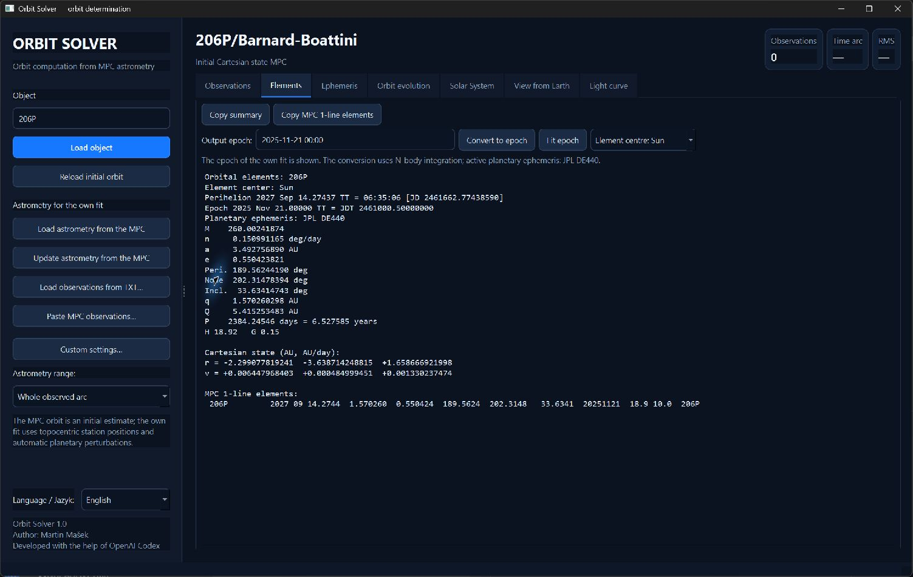
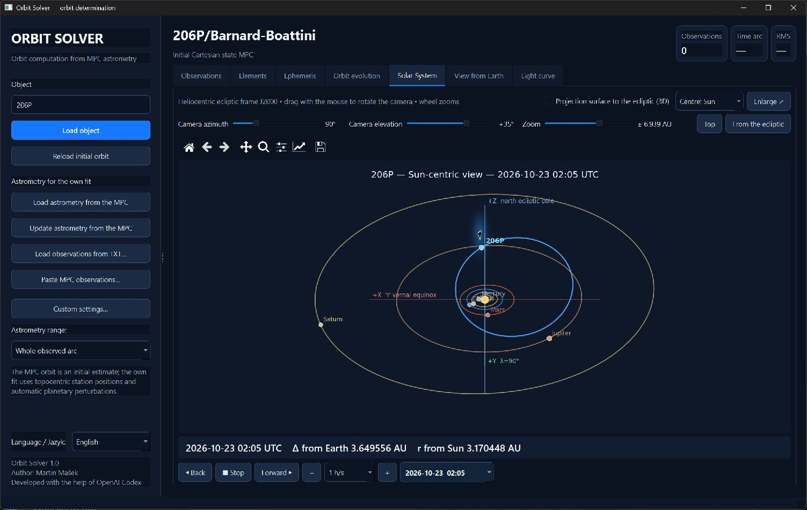

# Orbit Solver

[Česky](README.cs.md) | **English**

[](https://www.python.org/)
[](https://doc.qt.io/qtforpython-6/)
[](https://github.com/cassi-astronomy/Orbit-Solver)
[](LICENSE)

A desktop application for loading Minor Planet Center astrometry, determining
asteroid and comet orbits, generating ephemerides and visualising their motion.
It has an English and a Czech user interface and runs on Windows and Linux.

English is the default language. Czech can be selected with the
**Language / Jazyk** switch in the left panel; the application restarts in the
new language and remembers the choice for the next start.

## Example: comet 206P/Barnard-Boattini

Orbital elements loaded from the MPC, including the Cartesian state and the
MPC one-line representation:



The heliocentric J2000 ecliptic view shows the comet's orbit together with the
planetary orbits and their current positions:



## Main features

### Astrometry and orbit determination

- loading the initial Cartesian orbit from the Minor Planet Center;
- separate download of observations from the MPC or NEOCP/PCCP;
- local cache of MPC astrometry: once downloaded, the observations of an
  object (e.g. 1P) are stored in `orbit-data/mpc-cache` and loaded instantly
  next time without querying the MPC; **Update astrometry from the MPC**
  downloads the current data including new observations and overwrites the
  cache (NEOCP/PCCP objects change quickly and are not cached);
- for comets the MPC observation service omits the lettered records of a
  split comet (205P: 680 of 2016 rows); after it the program reads the MPC
  text listing of the object (the `show_object` page and its `tmp2/…txt`
  file) and adds the records of fragments A, B, C …, keeping the ADES rows
  with their uncertainties; without the MPC web site only the service rows
  are used; comets cached before this was added are downloaded once more;
- import of observations from a file or from the clipboard in the MPC
  80-column format;
- short arcs of objects very close to the Earth (down to a few Earth radii,
  e.g. 2008 TC3 an hour and 2024 BX1 minutes before impact): the preliminary
  range search reaches 10 000 km, includes the Earth's rotation of the
  observer, the Earth and the Moon, relaxes all six state components when the
  coarse search misses, and a trajectory passing through a planet is rejected
  as a collision; for 2024 BX1 the predicted entry (00:32:37 UTC, 15.20 km/s,
  75.6°) matches the observed bolide;
- long arcs of temporarily captured Earth satellites (for example J002E3)
  are initialized on the first dense local track and extended in phase-safe
  stages; the fit includes the Earth's J2 oblateness and screens a constant
  radial A1/r² solar-radiation-pressure term suitable for a hollow rocket
  stage;
- support for satellite observations and topocentric parallax from the MPC
  station code;
- own six-parameter fit of the Cartesian state with planetary perturbations;
- fast fitting of large data sets from a sample that is representative in
  time and number; long arcs, non-gravitational solutions and dense discovery
  arcs are finally corrected on all enabled measurements;
- computation from the whole arc or only from the last 2, 5 or 10 years;
- manual inclusion and exclusion of individual observations;
- colour-coded O−C residuals, automatic exclusion of residuals above 2″ and
  the `Worst obs` function;
- import of historical 80-column records with lower precision (RA to whole
  seconds or minutes, Dec to tenths of an arcminute); their uncertainty is
  never smaller than half of the last published digit;
- the complete per-observation ADES covariance: `rmsRA`, `rmsDec` and
  `rmsCorr`, with `rmsTime`/`uncTime` projected along the measured sky motion;
  uncertainties retain a floor of 0.3″ for unreported systematics;
  measurements without ADES RMS values get Vereš et al. (2017) technique,
  epoch and common-station defaults; a series from one station in one local night is
  deweighted by the `sqrt(N/4)` rule of Vereš et al. (2017), so hundreds of
  frames do not pretend to be hundreds of independent absolute positions;
- duplicate reductions of the same measurement (the MPC often lists them
  against several star catalogues, e.g. PPM and UCAC-4) are recognised and
  only the one with the best catalogue is fitted; records that the MPC marks
  as superseded (`X`, ADES `deprecated`) are not fitted;
- split comets: fragment labels from the MPC (column 12 of the 80-column
  format, e.g. `0205P      b`, or the `-B` suffix of an ADES designation) are
  recognised; when the astrometry contains several components, the
  **Comet fragment** selector appears and only the chosen component is fitted;
  the principal (surviving) component is preselected – the one labelled in
  the most observed returns, then the most observed one, so for
  73P/Schwassmann–Wachmann it is C, not the short-lived A; unlabelled
  measurements – the parent comet before the split, the survivor in later
  returns that the MPC no longer labels, or reports that did not resolve the
  fragments – belong to the principal component; rows of the other components stay in the
  table with O−C but no weight;
- an unlabelled second track measured by one station on the same exposures
  (a fragment or another object, e.g. ZTF on 205P in 2021, 65″ from the
  comet) is recognised even when it has dragged the orbit between the two
  tracks, and is excluded as a coherent secondary track (also when a weighted
  track first had to lose some rows as isolated outliers); likewise, a whole
  compact `trkSub`/station-night tracklet that is strongly incompatible with
  at least six well-fitted independent measurements is rejected as a unit,
  with a separate visible reason and a 15% safety limit;
- a banner above the observation table announces a split comet: components,
  observed period, nights and the median offset from the principal one on
  shared exposures; **Fragment overview…** lists the components with their own
  orbits. A detected unlabelled track can be made a component (**Split off
  track as fragment**, labels X1, X2…). A secondary component is fitted
  starting from the principal orbit (gravity only when its arc is shorter than
  a year). After each component fit, unlabelled post-split rows near the
  secondary's measurements are given to the component whose orbit they follow
  (within 3″ and three times closer than the other); rows both orbits fit
  equally stay with the principal component;
- **Estimate split time…** dates the separation of each fitted secondary from
  the principal component with three models – Sekanina's split with a
  differential radial acceleration (∝ r⁻²), a separation impulse Δv (R/T/N),
  and both – searching up to 1.6 orbital periods back; it reports the epoch with
  its uncertainty, heliocentric distance, Δv/ΔA1, competing solutions and
  warnings for unphysical velocities (> 10 m/s), excessive differential
  acceleration, or a minimum at the early edge of the search (epoch not
  determined); a minimum just before the first fragment measurement is a
  valid result – a fresh fragment – and is reported as such. Short fragment
  arcs often allow several epochs; the result is indicative;
- the other fitted components are drawn as companions (pink) in the Solar
  System and Sky views; the sky view also offers 0.25°, 1° and 5° fields;
- times before 1960 are Universal Time UT and are converted to TT with ΔT
  from the reconstruction of the Earth's rotation (Espenak & Meeus), not with
  a fixed 32.184 s offset;
- linkage of distant returns for any body (periodic comets, multi-opposition
  asteroids): observations are split into apparitions by gaps longer than half
  the orbital period (at least 300 days), and one apparition never spans more
  than three quarters of a period, so years of survey coverage do not merge
  consecutive returns; if the initial orbit predicts all
  apparitions, they are corrected together; otherwise the best observed
  return is fitted on its own (from the catalogue orbit, or from its own
  angles by gradually extending the arc) and the other returns are joined one
  by one, nearest in time first; when the prediction is not good enough for a
  differential correction, the correct branch is searched along the line of
  variations (LOV) – the weakest direction of the covariance, i.e. the family
  of orbits that still fit the already linked astrometry; each return is
  accepted only if it fits its own astrometry (normalized RMS ≤ 3σ after
  bounded and visible rejection of blunders); previously linked returns may
  shift by at most 6σ, and such model tension (typically variable cometary
  activity) is reported explicitly; returns that the linked orbit already
  predicts well are joined at once in a single correction; a return that
  failed is tried once more after further returns have been linked; requested A1/A2 are
  fitted as soon as the arc covers a full revolution (two perihelia), other
  requested parameters in the final joint solution; this way, e.g.,
  206P/Barnard–Boattini (1892 and 2008, 20 revolutions and three approaches to
  Jupiter) is linked even without a catalogue orbit;
- linkage options in **Custom settings…**: *separate non-gravitational
  parameters for historical returns* fits its own A1H/A2H/A3H before a switch
  epoch and A1–A3 after it (a comet whose activity changed while it was lost;
  205P: 1896 and 2008–2021); the switch defaults to the middle of the longest
  observing gap and can be set to any year inside a gap – best the moment the
  activity changed, e.g. a split far from the Sun; several years separated by
  commas give up to four force periods (A1–A3, A1H–A3H, A1H2–A3H2, A1H3–A3H3),
  each fitted from its own returns (78P with switches in 1993 and 2008, around
  the 1995 Jupiter approach: RMS 1.16″ against 1.42″ with two periods and 2.04″ with one set; the transverse A2 of the three periods, −0.66, −1.28 and −1.13·10⁻⁹ AU/day², follows Kinoshita's −0.43, −1.26 and −1.23); *join a return even above
  the quality limit* accepts a return up to 15σ as long as the other returns
  stay within the tension limit and always reports it as model tension;
  *increase the uncertainty of measurements made before a year* multiplies
  the σ of old micrometer and plate astrometry, whose systematic errors
  (catalogue, plate scale, observer) do not average out;
  for 205P (with JPL DE440, A1+A2 and A1H/A2H switched at the end of 1998,
  when fragment C separated) all four returns are linked without the
  above-limit option: 1896 at 9.5″/3.1σ, and with 3× larger uncertainty
  before 1950 at 12.8″/1.4σ, 2008–2021 at 1.0–1.9″; the historical A2H
  (+2.8·10⁻¹⁰) has the opposite sign of today's A2 (−3.6·10⁻¹⁰);
- a fit of an arc longer than 10 years without JPL DE440 warns before it
  starts and in the result: with the analytic planetary model the linkage
  across close Jupiter encounters can be completely wrong (206P, 1892–2008:
  8″ with DE440, 14 000″ without);
- integration of arcs longer than two years uses a precise tolerance
  (`rtol = 1e-12`); over centuries and close Jupiter encounters a looser
  tolerance would introduce errors of hundreds of arcseconds;
- optional fixing of osculating elements;
- a pre-selectable output epoch; for stability the fit stays in the middle of
  the observed arc and the resulting elements are converted afterwards by
  N-body integration;
- optional fit of the non-gravitational parameters A1, A2 and A3 for any
  body: the Marsden water-ice model with an optional activity time shift DT
  for comets, or the power law `g(r) = r^-m` (default `m = 2`) for radiation
  pressure and the Yarkovsky A2 of asteroids; the designation of the body does
  not restrict the function; when the user has not selected a force model,
  the fit conservatively tests A1 (and on a long enough comet arc A1+A2), or
  asteroidal r⁻² A2 on arcs over two years, but accepts it only when every new
  parameter is at least 3σ significant and the improvement is ΔBIC > 10;
- element uncertainties and basic fit diagnostics; with a singular or
  extremely ill-conditioned normal matrix the uncertainty is rather not shown
  than letting a pseudo-inverse produce a falsely precise number;
- for asteroids the elements report gives the diameter implied by H,
  D = 1329 km / √p_V · 10^(−H/5), for the typical albedo range 0.25 (bright
  S type) to 0.05 (dark C type) and the extreme limits 0.50–0.03; it is
  omitted for comets (H/M of an active comet measures the coma) and while H
  is only a placeholder (no catalogue H and no photometry);

### Elements and ephemeris

- overview of orbital elements including uncertainties;
- for linked returns (and for a comet with a long arc) the fit computes one
  integration from the first observed return to the first return after today;
  **Orbit evolution** shows it in full immediately – osculating elements at
  each return, planetary approaches, the element history in the plot and the
  trajectory in the Solar System – without running the integration again;
  the **Run integration** button is only for a different range;
- conversion of the elements to a user-selected epoch;
- osculating elements relative to the Sun; elements relative to a planet are
  offered only when the body is gravitationally bound to it (inside its Hill
  sphere with negative planetocentric energy, e.g. Shoemaker–Levy 9 around
  Jupiter or a temporarily captured minimoon);
- copyable text output and MPC 1-line elements;
- geocentric or topocentric ephemeris for a selected MPC station;
- numerical N-body propagation from the Cartesian state even for a purely
  gravitational orbit, TDB time argument and iterated light-time correction;
- astrometric RA/Dec in the ICRS/J2000 frame in decimal and sexagesimal
  format; the conversion to horizontal coordinates includes precession,
  nutation and aberration;
- azimuth, object altitude, Sun altitude, distances and elongation;
- formal 1σ position uncertainty in arcseconds;
- copying a rectangular selection from the table.

### Visualisation

- interactive Solar System view with rotation, smooth logarithmic zoom and a
  selectable centre on the Sun, a planet or the fitted body; the Earth-centred
  close view shows the Moon on a date-matched ephemeris orbit, and detected
  temporary-capture loops are reintegrated at fine cadence so they remain
  smooth even in a long evolution;
- the osculating curve of the body is derived from the N-body state of the
  current frame, so the animated point does not lie off an old curve from the
  epoch of the original fit;
- optional translucent projection surface between the orbit and the ecliptic
  plane to illustrate the inclination, the height above/below the ecliptic and
  the nodes;
- equatorial sky map, centred azimuthal projection and horizon visibility
  plot;
- stars to magnitude 6, the figures and Latin abbreviations of the 88
  constellations, the celestial equator and the ecliptic;
- free panning of the map, object tracking and a separate enlarged window;
- light curve for asteroids and comets with an adjustable photometric model
  and accompanying curves of the distance from the Earth and from the Sun; the
  heliocentric perihelion is marked in the plot.

### Long-term orbit evolution

- integration by the number of past/future returns or by a separate number
  of years in both directions; the panel shows the calendar years the choice
  covers, a range beyond the active planetary ephemeris (DE440: 1549–2650) is
  offered to be restricted to its coverage, and an integration over more than
  1000 years asks for confirmation;
- table of osculating elements at individual perihelion passages, labelled
  directly by the year of the return;
- optional **clone spread** (off by default, 5–500 clones): clones drawn from
  the covariance of the own fit – the state and the fitted A1/A2/A3/DT – are
  integrated over the same interval and drawn as faint curves with a 5–95 %
  band; the TXT summary lists the spread of q, e and P at every return. It
  shows how much of a prediction the observations determine, but only within
  the chosen force model: for 78P the 30 clones stay within q 5.051–5.057 AU
  even after the 2029 (0.018 AU) and 2046 Jupiter encounters, while a
  solution with a different non-gravitational model (Kinoshita) lands
  elsewhere – the model choice, not the astrometry, dominates there. Each
  clone is one more full integration (about 5 s for 125 years);
- search for planetary approaches, distance in AU and Hill radii, relative
  velocity and an approximate change of `1/a`;
- automatic detection of a planetocentric capture by negative relative
  orbital energy inside the Hill sphere;
- close lunar flybys are listed separately from Earth encounters; the Moon's
  gravity is included throughout the integration, so a lunar kick that changes
  a temporary capture or escape is retained in the trajectory;
- switchable plot of the continuous evolution of `q`, `a`, `e`, the period,
  `1/a`, inclination, node or argument of perihelion on a linear time axis;
  changes at encounters appear at the moment of the encounter and the
  encounters are marked in the plot;
- chronological export as a readable TXT table or MPC 1-line elements;
- the numerically integrated past and future trajectory is shown in clearly
  different colours in the Solar System; the current return is highlighted by
  a stronger light line during the animation, while older and future
  revolutions stay thin and muted; a significant planetary encounter is marked
  as a dynamical “switch” and at the moment of the flyby the highlight moves
  from the incoming to the outgoing branch; the animated position follows the
  real change of the orbit after the encounter;
- **relation to a planet** for a body orbiting the Sun: distance from the
  planet over time (logarithmic, with the Hill sphere and for the Earth the
  lunar distance), MOID — the minimum distance between the two orbits — (for
  the Earth with the 0.05 AU limit of potentially hazardous objects), the
  Tisserand parameter with respect to the planet (for Jupiter with the
  T = 2 and T = 3 class limits), the period ratio P / P_planet with nearby
  mean-motion resonances, and the nodal distances (where the orbit crosses
  the planet's orbital plane); planet orbits use the JPL mean elements with
  their secular rates;
- the encounter table also lists the hyperbolic excess speed v∞ and the
  changes of the Tisserand parameter and of the MOID caused by the encounter;
  the time of closest approach is found by a 1-D search on precise
  integrations, so even a flyby of a few hours is not missed;
- every own fit is checked for a collision with a planet or the Moon within
  one year after its epoch; a predicted impact is announced in a dialog and
  shown prominently in the Elements tab (time, place, uncertainty); the
  ephemeris, the view from Earth and the other previews end at the impact;
- **impacts**: a trajectory entering a planet or the Moon ends the
  integration at the moment of contact; for the Earth the program gives the
  time, geographic coordinates, air-relative speed and path angle of the
  atmospheric entry (100 km) and of the surface point of the vacuum
  trajectory (WGS84), with a Monte Carlo uncertainty from the fit covariance
  (impacting fraction of clones, 1σ ellipse on the ground, time); for
  2008 TC3 the entry agrees with the JPL prediction within 1 s and 1.4 km;
- a close nominal pass by the Earth or Moon also triggers Monte Carlo virtual
  impactor screening from the formal fit covariance, even when the nominal
  orbit misses; it uses a fixed number of 2,500 seeded clones
  (the same result on any computer; risks of about 1:800 and above are found
  reliably, rarer ones may show no impacting clone) and reports a Wilson 95%
  interval; when the fit determined A1/A2/A3/DT (e.g. a Yarkovsky A2), the
  clones vary them too, with their correlations to the state. A non-zero
  result is explicitly labelled as indicative and requires verification by an
  authoritative impact-monitoring system;
- optional planetocentric elements while a planet holds the body (capture);
  optional local planetocentric view for captured objects; lunar
  perturbations are included (from DE440, or with an approximate model
  without it);
- fragments of comet Shoemaker–Levy 9 can be loaded by their full
  designation, e.g. `D/1993 F2-A`; if the MPC does not provide a Cartesian
  state, the program automatically uses the historical heliocentric ecliptic
  vector of the fragment from JPL Horizons. For the general designation
  `D/1993 F2` the state of fragment G serves as a representative initial
  estimate; the disrupted comet no longer has a single orbit shared by all
  fragments.

## Requirements

- Python 3.10 or newer;
- an internet connection for MPC queries (cached astrometry also works
  offline);
- the packages listed in [`requirements.txt`](requirements.txt): PySide6,
  Matplotlib, NumPy, SciPy, Requests, Astropy and jplephem.

The star catalogue, constellation figures and the observatory catalogue are
part of the repository, so they are not downloaded just to display data that
is already loaded.

## Installation

First clone the repository:

```bash
git clone https://github.com/cassi-astronomy/Orbit-Solver.git
cd Orbit-Solver
```

### Windows

In PowerShell:

```powershell
py -3.11 -m venv .venv
.\.venv\Scripts\Activate.ps1
python -m pip install --upgrade pip
python -m pip install -r requirements.txt
python run.py
```

After installation the program can also be started by double-clicking
`Orbit.cmd`, provided that the `python` command points to the environment with
the installed dependencies.

If PowerShell refuses to activate the virtual environment, local scripts can
be allowed for the current window:

```powershell
Set-ExecutionPolicy -Scope Process Bypass
```

### Linux

On Debian/Ubuntu:

```bash
sudo apt update
sudo apt install python3 python3-venv libxcb-cursor0
python3 -m venv .venv
source .venv/bin/activate
python3 -m pip install --upgrade pip
python3 -m pip install -r requirements.txt
python3 run.py
```

On other distributions use the corresponding packages for Python, `venv` and
Qt 6. PySide6 brings most Qt libraries in its own wheel. If a problem with the
graphics backend appears under Wayland, try X11/XWayland:

```bash
QT_QPA_PLATFORM=xcb python3 run.py
```

## Basic workflow

1. Enter a designation or a name in the **Object** field, e.g. `9841`,
   `C/2024 Y1` or `Lovejoy`.
2. Load the initial MPC orbit with **Load object**. If several bodies match
   one name, the program offers a choice in order of discovery.
3. Load the astrometry separately with **Load astrometry from the MPC**, from
   a text file or from the clipboard. If the astrometry of the object has been
   downloaded before, it is loaded from the local cache (the status bar shows
   the download date); get new observations with **Update astrometry from the
   MPC**. For an object on the NEOCP/PCCP the program downloads the
   observations and builds its own initial estimate, because a catalogue orbit
   may not exist yet.
4. If needed, restrict the time range, exclude bad measurements and choose
   **Compute own orbit**.
   The automatic fit uses ADES uncertainties, checks outlying measurements by
   whole observing series and visibly unchecks the rejected rows in the table.
   For a short arc with at least six measurements it first quickly screens
   several different distance branches (even when a preliminary estimate
   already exists), refines the best one from all observations and only then
   may reject truly large residuals. It also compares a free and a nearly
   parabolic branch, so that a few bad late measurements do not pull the
   solution into another local orbit.
   If the arc is too short or the usual initial estimate fails, use
   **Preliminary orbit from a short arc**. The recommended systematic search
   scans distance and radial velocity and, from six measurements on, also
   performs a robust differential correction; the alternative Väisälä method
   creates a hypothesis for a manually entered perihelion distance `q`.
5. Inspect the result in the **Elements**, **Ephemeris**, **Orbit evolution**,
   **Solar System**, **View from Earth** and **Light curve** tabs.

Fits, position uncertainties and long-term integrations run in the background,
so the user interface stays responsive.

## Accuracy and limitations

Orbit Solver is a working and visualisation tool. For important applications
the results must be compared with the MPC, JPL Horizons or other independent
software.

- The N-body model includes perturbations by the eight planets and the Pluto
  system. Without the optional kernel it uses their analytic mean elements;
  in **Custom settings…** JPL DE440 (about 114 MB, 1549–2650) can be
  downloaded and activated with one click. Computations outside the coverage
  of the active kernel are refused instead of silently falling back to a less
  precise model.
- The Moon, the Earth's J2 oblateness for close geocentric trajectories, and
  the first post-Newtonian (Schwarzschild) correction of the Sun are included.
  The 16 massive asteroids are added automatically when optional
  [ASSIST](https://github.com/matthewholman/assist) is installed and the JPL
  [`sb441-n16.bsp`](https://ssd.jpl.nasa.gov/ftp/eph/small_bodies/asteroids_de441/sb441-n16.bsp)
  kernel is placed beside `de440.bsp` in `orbit-data` (or
  `ORBIT_SOLVER_DATA_DIR`). Install the adapter with `pip install assist
  rebound`; Windows may require WSL2 until suitable wheels are available.
  ASSIST is GPL-3.0 and remains an unbundled optional component. The full
  EIH/PPN model is still not implemented.
- The linkage of returns assumes one common force model. A return that the
  joint solution does not confirm is explicitly flagged and shown only as a
  prediction; this alone does not disprove the identity of the returns.
- Eggl et al. (2020) catalogue zonal and proper-motion debiasing is activated
  when `bias.dat` from the official JPL
  [`debias_2018.tgz`](https://ssd.jpl.nasa.gov/ftp/eph/small_bodies/asteroids_debias/debias_2018.tgz)
  archive is placed at
  `orbit-data/debias_2018/bias.dat` (or under `ORBIT_SOLVER_DATA_DIR`). It is
  intentionally not bundled; without the table the fit remains unchanged and
  reports no debias correction.
- Constant A1/A2/A3/DT when integrating a comet over many returns are a model
  assumption; the real non-gravitational activity of a comet may change
  between returns. DT should be released only for a long arc, because on a
  single short apparition it is usually strongly correlated mainly with A2.
- Very close passes near the surface of Jupiter do not yet include its
  oblateness or the Galilean moons. The reconstruction of the Shoemaker–Levy 9
  breakup therefore remains approximate, although the planetocentric frame and
  the point-mass gravity of Jupiter work.
- Position uncertainties are formally propagated from the covariance of the
  fitted state; they do not include all possible systematic errors of the
  measurements or the model.
- RA/Dec in the ephemeris table are deliberately astrometric ICRS/J2000
  coordinates corrected for light time, i.e. the counterpart of the
  astrometric result of `observe()` in Skyfield. They are not apparent RA/Dec
  for the current equinox; pointing a telescope directly requires a conversion
  to apparent coordinates or the displayed topocentric azimuth and altitude.
  Atmospheric refraction is not estimated without the local pressure and
  temperature.
- The impact point on the ground is where the vacuum trajectory meets the
  WGS84 ellipsoid; atmospheric deceleration, fragmentation and wind are not
  modelled, so it is not a strewn-field prediction. The Monte Carlo spread
  reflects the formal fit covariance of the state only.
- A single preliminary orbit from a very short arc is not a unique solution.
  It serves as an initial estimate for the differential correction; in this
  mode the ephemeris is preset to 10-minute steps over the next 48 hours and
  its real uncertainty may grow quickly.
- The photometric prediction is model-based. For comets the real activity and
  brightness may differ considerably from the computed curve.
- Very long integrations and large observation sets may take tens of seconds
  or longer depending on the processor and the selected model.

## Tests

After installing the dependencies run:

```bash
python -m unittest discover -s tests -v
```

On Linux `python3` may be used instead of `python`.

For development the project can be installed in editable mode including the
Ruff static check:

```bash
python -m pip install -e ".[dev]"
python -m ruff check .
python -m unittest discover -s tests -v
```

GitHub Actions runs the same checks for every push and pull request. The tests
make no live MPC/JPL queries and do not download DE440; network interfaces and
expensive numerical branches are replaced by test data or mocks where needed.
Pure formatting and projection functions are separated in
`orbit_app/presentation.py`, which does not depend on Qt or Matplotlib. On a
system without PySide6 at least the separate core check can be run:

```bash
python -m unittest tests.test_headless -v
```

## Project structure

```text
Orbit-Solver/
├── orbit_app/
│   ├── main_window.py       # Qt interface and visualisation panels
│   ├── mpc.py               # MPC/NEOCP astrometry and MPC80 parser
│   ├── mpc_cache.py         # local cache of downloaded MPC astrometry
│   ├── mpc_orbit.py         # loading MPC orbits and element conversion
│   ├── astrometry.py        # measurement weights, duplicate reductions, normal places
│   ├── orbit_fit.py         # differential correction and residuals
│   ├── linkage.py           # linkage of returns by line-of-variations search
│   ├── orbit_engine.py      # numerical N-body propagation
│   ├── orbit_evolution.py   # returns and planetary approaches
│   ├── planet_relations.py  # MOID, Tisserand parameter, resonances, nodal distances
│   ├── impact.py            # impact location and its Monte Carlo uncertainty
│   ├── comet_dynamics.py    # original/future barycentric comet orbits
│   ├── observatories.py     # stations, parallax and horizontal coordinates
│   ├── presentation.py      # pure formatting and projections without Qt
│   ├── preview_orbit.py     # ephemeris and preview geometry
│   ├── photometry.py        # brightness models
│   ├── i18n.py              # interface language selection and tr()
│   ├── translations_en.py   # English catalogue of interface texts
│   └── data/                # offline star, constellation and station catalogues
├── .github/workflows/       # automatic Ruff and unittest checks
├── tests/
├── pyproject.toml           # project metadata and development tool configuration
├── run.py
├── Orbit.cmd
└── requirements.txt
```

## Third-party data and services

- Orbital and astrometric data are loaded from the
  [Minor Planet Center](https://www.minorplanetcenter.net/) interface.
  Downloaded astrometry is stored in `orbit-data/mpc-cache` (gzip JSON, one
  file per object); the cache can be deleted at any time and the program
  downloads the data again when needed.
- The optional DE440 planetary ephemeris is downloaded directly from the
  official [NASA/NAIF archive](https://naif.jpl.nasa.gov/pub/naif/generic_kernels/spk/planets/).
  The program verifies its published checksum before activation.
- The star catalogue and constellation figures come from the
  [d3-celestial](https://github.com/ofrohn/d3-celestial) project and are
  distributed under the BSD-3-Clause licence. Its text is stored in
  [`orbit_app/data/D3_CELESTIAL_LICENSE.txt`](orbit_app/data/D3_CELESTIAL_LICENSE.txt).

## Author and acknowledgements

**Author:** [Martin Mašek](https://github.com/cassi-astronomy)

The program was developed with the help of OpenAI Codex. Astronomical data are
provided by the Minor Planet Center; the star catalogue and constellation
figures come from d3-celestial.

## Development and planned steps

Possible next steps are the full EIH/PPN model, massive asteroids, saving
projects and distribution packages for Windows and Linux.

Contributions and reports of reproducible bugs are welcome via
[GitHub Issues](https://github.com/cassi-astronomy/Orbit-Solver/issues). A
report should preferably include the object designation, the source of the
observations, the selected settings, the expected result and the
`orbit-crash.log` file, if one was created.

## Licence

The source code is available under the free [MIT](LICENSE) licence. Copyright
© 2026 Martin Mašek.

The licence of the bundled d3-celestial data is given separately in the
`orbit_app/data` directory.
